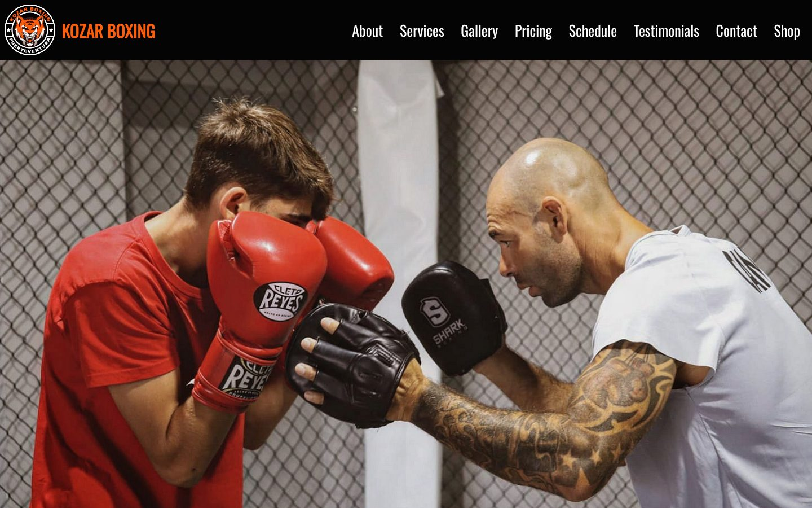
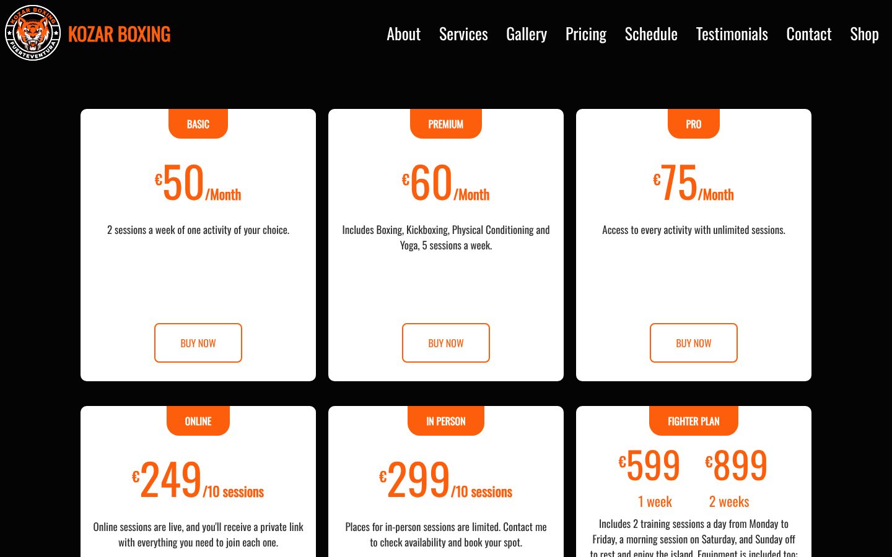
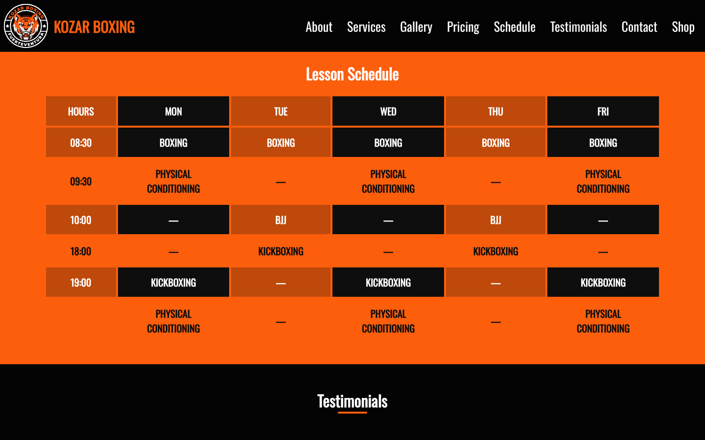
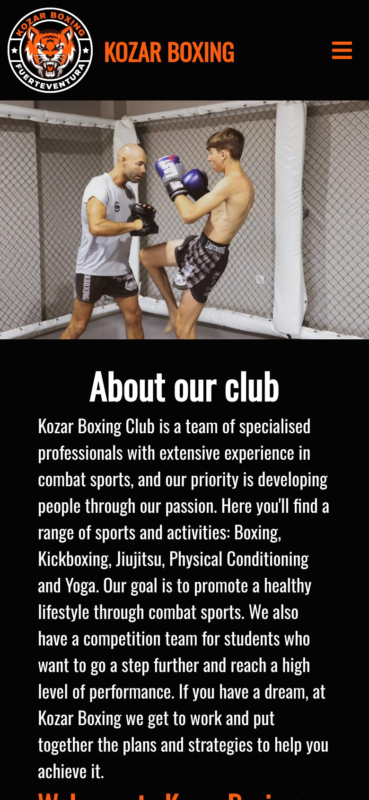

# Kozar Boxing

A responsive one-page website for **Kozar Boxing**, a combat sports club in Fuerteventura, Canary Islands. It offers boxing, kickboxing, Brazilian jiujitsu, yoga and physical conditioning.

Built with plain HTML, CSS and JavaScript (no framework, no build step), plus a small PHP script for the contact form.



| Pricing | Lesson schedule | Mobile |
| :---: | :---: | :---: |
|  |  |  |

## Features

- **Responsive layout** for desktop, tablet and phones, with a slide-out menu on small screens
- **Activity flip cards** with a photo on the front and a description on the back
- **Instructor profiles** with Instagram links
- **Plan tabs** to switch between the group, personal and fighter training plans
- **Photo gallery and testimonials sliders** powered by [Swiper](https://swiperjs.com/)
- **Pricing and shop cards** with hover effects
- **Weekly lesson schedule**: a full timetable on wide screens and one table per day on phones
- **Contact form** that sends an e-mail through `mail.php`
- **Embedded Google Map**, plus phone, e-mail and Instagram in the footer
- **Reveal-on-scroll animations**

## Built with

| | |
| --- | --- |
| Markup & styles | HTML5, CSS3 (Flexbox, custom properties) |
| Scripts | Vanilla JavaScript (ES6) |
| Slider | [Swiper 8.3.1](https://swiperjs.com/) (self-hosted in `assets/vendor/`) |
| Icons | [Font Awesome](https://fontawesome.com/), [Boxicons](https://boxicons.com/) |
| Font | [Oswald](https://fonts.google.com/specimen/Oswald) (Google Fonts) |
| Contact form | PHP `mail()` |

## Project structure

```
.
├── index.html                 # the whole page
├── mail.php                   # contact form handler
├── assets/
│   ├── css/styles.css         # all styles; responsive rules at the bottom
│   ├── js/main.js             # menu, tabs, sliders, scroll animation, form status
│   ├── vendor/swiper/         # Swiper library (CSS + JS)
│   └── img/
│       ├── brand/             # logos
│       ├── hero/              # header photo (desktop + mobile)
│       ├── activities/        # flip-card photos
│       ├── instructors/       # portraits + card banner
│       ├── services/          # image beside the plan tabs
│       ├── gallery/           # gallery-01.jpg … gallery-10.jpg
│       ├── shop/              # merch photos
│       └── unused/            # assets not used on the page
└── docs/screenshots/          # images for this README
```

## Getting started

Clone the repository and open the page:

```bash
git clone https://github.com/<your-username>/kozar-boxing.git
cd kozar-boxing
```

**Just the page.** Open `index.html` in a browser, or serve the folder:

```bash
python3 -m http.server 8000
# → http://localhost:8000
```

**With the contact form.** It needs PHP, so use PHP's built-in server instead:

```bash
php -S localhost:8000
```

> Locally the form will redirect with an error unless your machine has mail sending set up. That's expected. It works on a regular PHP web host.

## Contact form setup

`mail.php` checks the submitted fields, sends them as a plain-text e-mail, then redirects back to `index.html?contact=sent#contact` (or `?contact=error`) so the page can show a confirmation message.

To change where messages are delivered, edit the constant at the top of `mail.php`:

```php
const RECIPIENT = 'you@example.com';
```

The visitor's address is set as **Reply-To**, so pressing "Reply" in your mail app answers them directly.

## Deployment

- **PHP web hosting** (most shared hosts): upload all files to the web root. Everything works, including the contact form.
- **GitHub Pages / Netlify / Vercel (static)**: the site works, but **the contact form won't**, because these hosts can't run PHP. To fix that, point the form's `action` at a form service such as Formspree or Netlify Forms instead of `mail.php`.

## Editing content

| To add… | Do this |
| --- | --- |
| A gallery photo | Put `gallery-11.jpg` in `assets/img/gallery/` and copy a `gallery-slider__slide` line in `index.html` |
| A pricing plan | Copy an `offer-card` block inside `.pricing__grid` |
| A shop product | Copy an `offer-card offer-card--product` block inside `.shop__grid` |
| An instructor | Add the portrait to `assets/img/instructors/` and copy an `instructor-card` block |
| A class | Update **both** schedule tables: `.schedule__week` (wide screens) and `.schedule__days` (phones) |

Brand colours live in CSS variables at the top of `assets/css/styles.css`:

```css
:root {
    --color-accent: rgb(252, 94, 12);   /* Kozar orange */
    --color-black: rgb(4, 4, 4);
    ...
}
```

## Code conventions

- **Files & folders:** lowercase, hyphen-separated (`brazilian-jiujitsu.jpg`). Many servers are case-sensitive.
- **CSS classes:** [BEM](https://getbem.com/) naming: `block`, `block__element`, `block--modifier` (for example `.offer-card__price`, `.offer-card--product`).
- **State classes:** `is-` prefix, toggled by JavaScript (`.is-active`, `.is-open`, `.is-visible`).
- **JS hooks:** `js-` prefix for elements found by scripts but not styled (`.js-slider`).
- **IDs:** used only as menu anchor targets (`#about`, `#pricing`, …), never for styling.

## To do

- [ ] Replace placeholder text on the Boxing, Kickboxing, BJJ and Physical Conditioning cards
- [ ] Add real testimonials
- [ ] Add instructor bios
- [ ] Hook the "Buy Now" buttons up to a payment or booking system (they currently scroll to the contact form)
- [ ] Fix the week timetable overflowing sideways on screens about 900–1060px wide

## Credits

- Photos, logo and club content © Kozar Boxing
- [Swiper](https://github.com/nolimits4web/swiper) is MIT licensed
- [Font Awesome Free](https://fontawesome.com/license/free) and [Boxicons](https://github.com/atisawd/boxicons) icons
